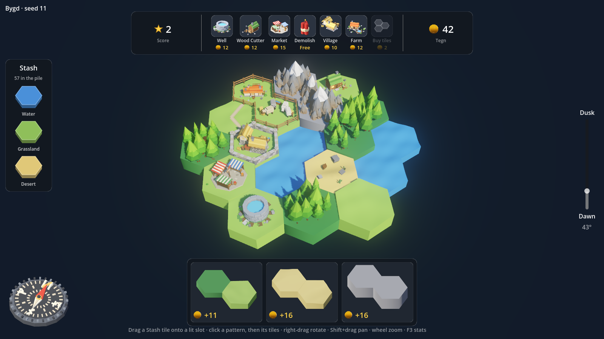

  

**Bygd** is a small real-time hex-tile builder. You draw terrain tiles, match patterns for coins (*Tegn*), spend them on farms, wells,
wood cutters and markets, and keep your villages supplied so they grow. Let a district go hungry or thirsty and it shrinks again.

This is an **early playtest build for friends**. It is unfinished, it will have rough edges, and your feedback is exactly what it is for.

  

## Download and play (Windows)

1. Download [`download/Bygd-windows.zip`](download/Bygd-windows.zip) (about 53 MB; use the *Download raw file* button on that page).
2. Unzip it anywhere and run **`Bygd.exe`**. There is no installer, and nothing else is needed.
3. Windows SmartScreen may say the app is unrecognised, because the build is not code-signed. Click **More info**, then **Run anyway**.

Needs a Windows 10 or 11 PC (64-bit) with a graphics card that supports Vulkan (anything from the last ten years or so). The interface
scales with the UI scale option in Settings.

## How to play

- **Tiles.** You get 60 terrain tiles in a run: three in the *Stash* on the left, the rest in a pile. Drag a tile onto a lit slot next to
  your land. Water, grass, forest, mountain and desert all behave differently.
- **Patterns.** The box at the bottom offers patterns such as "two forests and a lake". Click a pattern, then click the matching tiles on the
  board to claim it for Tegn. Every asset standing on the claimed tiles adds 10% to the reward.
- **Assets.** The toolbar at the top sells what you can build. Drag an item onto a free land tile; the price is taken when you drop it.
  - **Village**: needs water and food, and grows with them. A well-fed village becomes a **Big Village**, which also wants wood.
  - **Well**: gives water, but only with a water tile within 2 hexes.
  - **Farm**: gives food and needs water. Drag another Farm onto it to level it up (sheep, then cows), which takes a pen tile with it.
  - **Wood Cutter**: turns the timber of a forest next to it into wood. Stack a second one for a Logging Camp.
  - **Market**: gathers up to four producers and delivers their goods to the settlements around it.
  - **Demolish**: free; blows up a tile if you change your mind.
- **Roads** appear by themselves between nearby assets, and bridges cross a single water tile. Supply travels along them.
- **Warnings.** A turning triangle over an asset means it is missing something. A green arrow over a village means it would level up
  with more supplies. Hover or click an asset to see exactly what it takes in, puts out and stores.
- **Score** is the sum of your settlement levels.
- **Out of tiles?** Once the pile and your hand are empty, **Buy tiles** lights up on the toolbar: three tiles for a price that climbs the
  more you have placed. If you place your last tile and cannot afford more, the run ends with a **Game Over** and your total score. You
  can close that panel to look at your world (and press U to bring it back).

### Controls

| Key | |
|---|---|
| Esc | The menu: Resume, three save slots, Settings, Quit |
| Right-drag, Q / E | Rotate the camera |
| Middle-drag, Shift + drag, W A S D | Pan the camera |
| Mouse wheel | Zoom |
| U | Hide or show the interface (good for screenshots) |
| F3 | Frame rate and render stats |
| F6 / F7 | Try-out: level the settlement under the mouse up or down |

### Saving

Three save slots. The game saves itself into the slot you started it in every 20 seconds, when you open the menu and when you quit.
Pick a used slot in the menu to load or delete it. Every new game uses a fresh random world.

The settings menu has options for shadows, light, animations, MSAA, glow, depth of field, UI scale and volume. If it runs slowly,
turn off shadows or the effects first.

## Known gaps

Town and City art, a tutorial, most sound effects (clicks and animals), and balance are all still to do. Market assignment is "sticky"
after roads change. If you find a bug, a confusing moment or a number that feels wrong, please tell me what you did, what you
expected, and the seed shown in the top-left corner when you can.

## Credits

A game by Daniel Melin. Built with [Godot 4](https://godotengine.org). Made with help from Claude.
