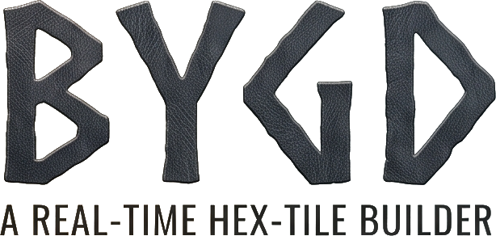
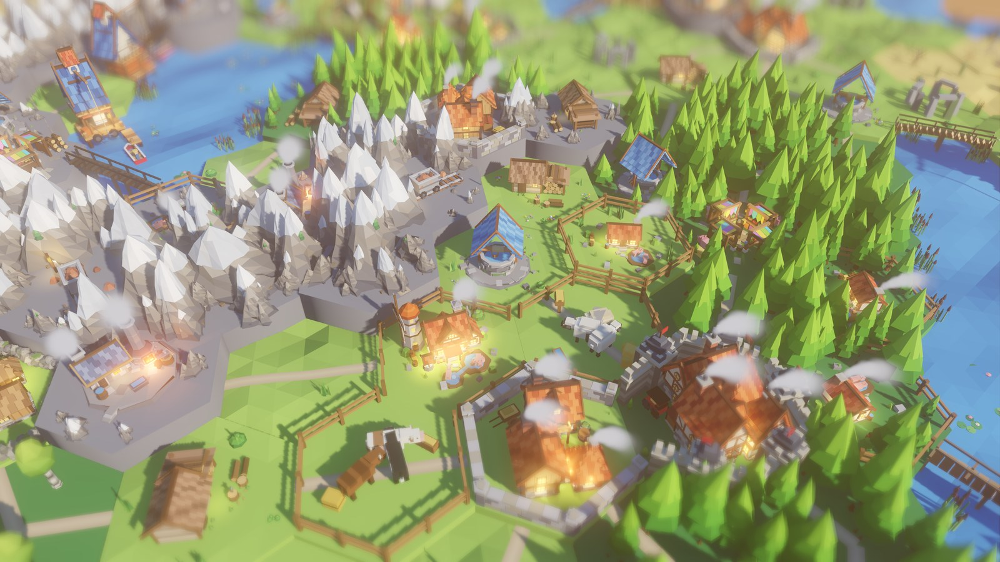
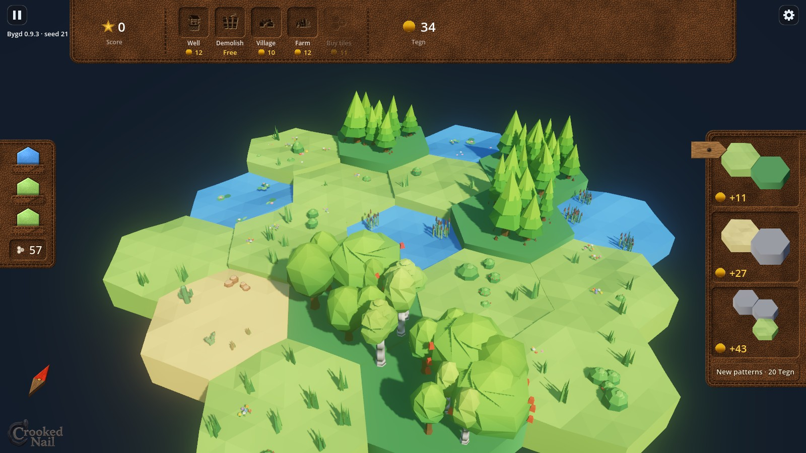
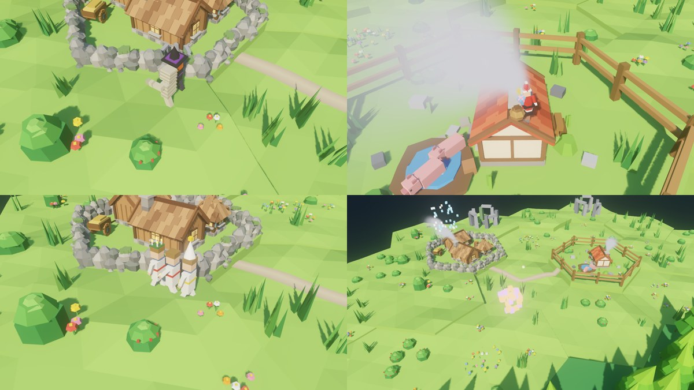
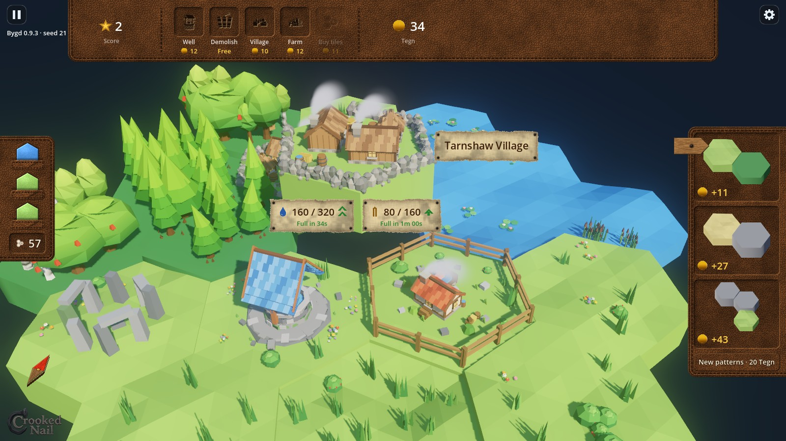

  

**Bygd**, by Crooked Nail, is a small real-time hex-tile builder. You draw terrain tiles, match patterns for coins (*Tegn*), spend them on farms, wells,
wood cutters, mines and markets, and keep your villages supplied so they grow. Let a district go hungry or thirsty and it shrinks again.

This is **version 1.5.0**. It is in English and Swedish, and your feedback is still very welcome.

  

  

<a href="images/bygd_trailer.mp4"><b>Watch the 48-second trailer</b></a> (an early build: a map growing from nothing, no interface)

## What is new since 1.0

  

- **Holidays (1.5):** the map dresses up for the Swedish holidays, for a week around each: pumpkin lanterns, a witch and a mummy (Halloween), spruces and Santa at a chimney (Christmas), maypoles (Midsummer), eggs (Easter), Valborg bonfires, Lucia's procession and Kräftskiva tables. New Year's fireworks go off at midnight and last two minutes. You can switch it off in the settings.
- **Big maps keep their look (1.5):** on very large boards tiles could lose their thickness and colour; that is fixed, and settlements no longer outgrow their level.
- **The Flying Dutchman (1.4):** very rarely a ghost galleon rises out of two empty water tiles, sails across firing its cannons and dives again. Click him for one Tegn per tile on your map.
- **What holds a settlement back (1.3):** the level-up card names what is missing: water, food, wood, stone goods or tools, or a lower neighbour.
- **An online scoreboard (1.2):** when a game ends you can post your name, score and a picture of your map to [bygdgame.com/scoreboard](https://bygdgame.com/scoreboard). Nothing is sent unless you press Post score.
- **A keeper for the Cursed tile (1.1):** a zombie with a swinging lantern, and a card that shows what a settlement needs to level up.

Every version's notes are on the [releases page](https://github.com/dmelin/bygd-releases/releases).

## What was new in 1.0

- **A leather and wood interface:** the store hangs from the top of the screen like a stitched leather panel, the Stash is a leather strip with the tiles inlaid, the patterns are leather too (a wooden arrow hides and shows them), and the compass is a wooden needle that turns and tilts with the camera.
- **Click a tile:** it lifts off the ground with what stands on it, and a parchment note shows what it makes while cards under it show what a building needs (stored and capacity, and when it runs empty or full). Hover a line to see ribbon arrows to everything it supplies, or to everything that supplies the need. Let go and the tile drops with a bounce, a clunk and a shockwave. The focus holds on the tile you picked.
- **Wooden boards on ropes:** the store's tips drop in on ropes from behind the store; pick a pattern and the store slides away and a board hangs in its place, telling you how many tiles to tag and whether the shape must be exact or may be any group.
- **Banners:** messages are colour-coded ribbons at the bottom of the screen (green good news, red a problem, blue information) that go after a few seconds, or when you click them.
- **Your own names, in two languages:** farms and settlements keep their names (Moas Farm, Brunswick Village; in Swedish Moas Gård, Brunswicksby), and the whole game can be switched to Swedish in the settings.
- **Faster, and a new face:** the supply calculation is much cheaper, there is a new title and loading picture, and the game has its own icon.

  

## Download and play

Every build is attached to the **[1.5.0 release](https://github.com/dmelin/bygd-releases/releases/tag/v1.5.0)** on this page (and the website, **[bygdgame.com](https://bygdgame.com)**, has them too).

**Windows**

1. Download **Bygd-windows.zip** (about 62 MB).
2. Unzip it anywhere and run **`Bygd.exe`**. There is no installer, and nothing else is needed.
3. Windows SmartScreen may say the app is unrecognised, because the build is not code-signed. Click **More info**, then **Run anyway**.

Needs a Windows 10 or 11 PC (64-bit) with a graphics card that supports Vulkan (anything from the last ten years or so).

**macOS**

1. Download **Bygd-macos.dmg** (about 85 MB), open it and drag **Bygd** to Applications.
2. The app is not notarised by Apple, so the first time, right-click it and choose **Open**, then **Open** again.

Runs on Intel and Apple Silicon Macs.

The interface scales with the UI scale option in Settings.

## How to play

- **Tiles.** You get 60 terrain tiles in a run: three in the *Stash* on the left, the rest in a pile (the number on the Stash is what is left in the pile). Drag a tile onto a lit slot next to
  your land. Water, grass, forest, mountain and desert all behave differently.
- **Patterns.** The panel on the right offers patterns such as "two forests and a lake". Click a pattern, then click the matching tiles on the
  board to claim it for Tegn. Some patterns want an exact row or chain in the order shown; others take any connected group. Every asset standing on the claimed tiles adds a little to the reward, and big patterns pay tiles too.
- **Assets.** The store at the top sells what you can build. Drag an item onto a free land tile; the price is taken when you drop it. New items appear as you progress.
  - **Village**: needs water and food. It grows with them and becomes a **Big Village** (needs wood too), a **Small Town** (stone goods) and a **Big Town** (tools). A settlement
    is worth more points the higher its level. A settlement cannot level up while a neighbour is of a lower level.
  - **Well**: gives water, but only with a water tile within 2 hexes (the tiles that are too far light up amber while you drag it).
  - **Farm**: gives food and needs water. Drop another Farm on it, twice, to expand it (sheep, then cows); each expansion takes a pen tile.
  - **Wood Cutter**: goes on or next to a forest and takes the timber of one forest. Stack a second one for a Logging Camp, which needs a second forest next to it.
  - **Market**: gathers up to four producers and delivers their goods to the settlements around it. Its chest earns Tegn: click the Market to collect.
  - **Mine**: on a mountain, it makes rock and iron. A **Stone Mason** or **Smithy** right next to it turns the rock into stone goods, or the iron into tools. A mine feeds up to two of each.
  - **Fishing Hut**: goes on a water tile with grass next to it and fishes for food; a Market can catch it. It cannot be upgraded.
  - **Demolish** (free) blows up everything on a tile; **Remove Tile** takes a whole tile off the map for a price.
- **Supply.** Producers reach as far as their range allows, and roads make it reach further. A storage only takes what it can hold plus what it uses, so what one house does not
  need goes to the next. Roads and bridges appear by themselves between nearby assets.
- **Notes and cards.** Click a tile to see what it makes and what the building on it needs (see above). Click anywhere else to let it drop.
- **Warnings.** A turning triangle over an asset means it is missing something. A green arrow over a village means it would level up with more supplies.
- **Out of tiles?** Once the pile and your hand are empty, **Buy tiles** lights up in the store: three tiles for a price that climbs the more you have placed. If you place
  your last tile and cannot afford more, the run ends with a **Game Over** and your total score. You can close that panel to look at your world (and press U to bring it back).

### Controls

| Input | |
|---|---|
| Space | Pause and unpause (night falls, the panels hide while it is paused) |
| Esc | The menu (pauses the game): Resume, three save slots, Settings, Quit |
| Click a tile | Open its notes and cards; click elsewhere to close them |
| Double click a tile | Pan the map so that tile is in the middle of the playing area |
| Left-drag, middle-drag, Shift + drag, W A S D | Pan the camera (panning keeps your selection) |
| Right-drag, Q / E | Rotate the camera (the compass needle turns with it; click it to turn back) |
| Mouse wheel | Zoom |
| U | Hide or show the interface (good for screenshots) |
| F3 | Frame rate and render stats |

### Saving

Three save slots. The game saves itself into the slot you started it in every 20 seconds, when you open the menu and when you quit.
Pick a used slot in the menu to load or delete it. Every new game uses a fresh random world.

The settings menu has the language, presets and options for shadows, light, animations, MSAA, glow, depth of field, UI scale and volume. If it runs slowly,
run the performance test, or pick the Performance or Potato preset.

## Known gaps

Balance, and what the desert is good for, are still being worked on, and Market assignment is "sticky" after roads change. If you find a bug, a
confusing moment or a number that feels wrong, please tell me what you did, what you expected, and the version and seed shown in the top-left corner when you can.

## Credits

Developed by Crooked Nail. Built with [Godot 4](https://godotengine.org). Made with help from Claude.
